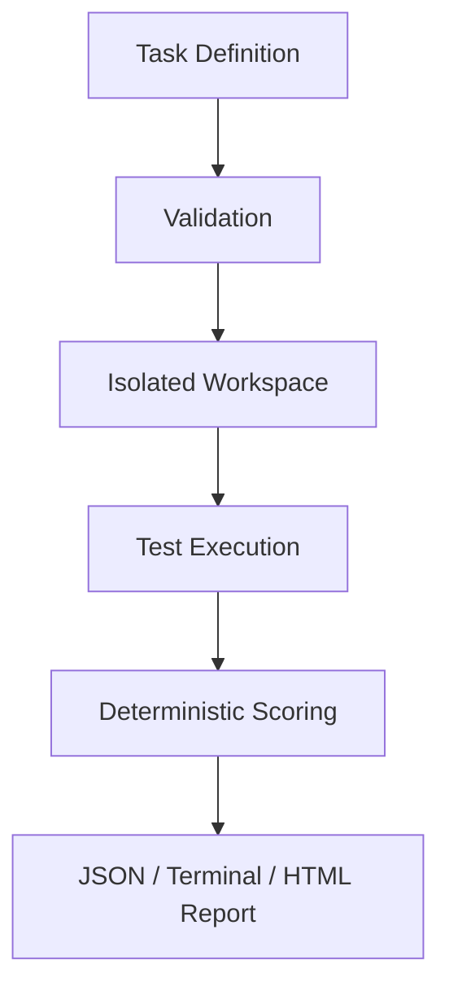

# RepoGym

RepoGym turns real software issues into reproducible, testable, and quantitatively scored AI
coding tasks.

AI coding evaluations are most useful when the task contract, starting state, hidden checks,
and scoring formula can be inspected and replayed. RepoGym packages those pieces in a small,
versioned directory and produces durable run artifacts instead of a single opaque pass/fail.

## Features

- Strict Pydantic validation for task metadata and path constraints
- Public and private pytest suites with reference-solution verification
- Temporary workspaces and a replaceable executor interface
- Deterministic correctness, regression, static-quality, and scope scores
- Terminal, JSON, and self-contained HTML reports
- Defensive handling of path traversal, symbolic links, timeouts, and undecodable output
- Two original, runnable Python tasks

## Quick start

RepoGym requires Python 3.11 or newer.

```bash
git clone https://github.com/chenwei217/RepoGym.git
cd repogym
python -m pip install -e ".[dev]"
repogym --help
repogym list
```

Validate and verify a task, grade the included correct submission, and render its report:

```bash
repogym validate tasks/python-cache-ttl
repogym verify tasks/python-cache-ttl
repogym grade tasks/python-cache-ttl --submission examples/submissions/cache-ttl-fixed
repogym report .repogym/runs/<run-id> --format html --output report.html
```

Run the project checks:

```bash
ruff check .
ruff format --check .
mypy src/repogym
pytest --cov=repogym --cov-report=term-missing
```

## CLI

| Command | Purpose |
| --- | --- |
| `repogym list [--tasks-dir PATH]` | Discover valid task definitions |
| `repogym validate TASK` | Check metadata, paths, and required files |
| `repogym verify TASK` | Prove the starter fails and the reference fix passes |
| `repogym grade TASK --submission DIR` | Grade a candidate in a temporary workspace |
| `repogym report RUN --format terminal\|json\|html` | Re-render saved run artifacts |
| `repogym version` | Print the installed version |

Pass `--debug` before a command to show tracebacks for expected domain errors.

## Task specification

Each task owns its prompt, starter tree, test suites, and reference patch:

```text
tasks/my-task/
├── task.yaml
├── prompt.md
├── starter/
├── tests/
│   ├── public/
│   └── private/
└── reference/
    └── solution.patch
```

```yaml
id: my-task
title: Repair an edge case
difficulty: medium
language: python
version: "1.0"
description_file: prompt.md
execution:
  timeout_seconds: 30
  test_command: python -m pytest -q
  working_directory: "."
scoring:
  correctness: {weight: 60}
  regression_safety: {weight: 20}
  code_quality: {weight: 10}
  scope_control: {weight: 10}
expected:
  failing_tests_before: 2
  passing_tests_after: 8
constraints:
  allowed_paths: [src/**, tests/**]
  forbidden_paths: [pyproject.toml, repogym/**]
```

See [Task authoring](docs/task-authoring.md) for the complete design guidance.

## Scoring model

Scores are calculated at run time; no result is hard-coded. Correctness is the weighted ratio
of all passed tests. Regression safety applies the same formula to public tests. Code quality
splits its weight equally between Python syntax and Ruff. Scope control gives full credit for
in-scope changes, proportionally deducts outside changes, and gives zero if a forbidden path is
changed. See [Scoring](docs/scoring.md) for edge cases and exact formulas.

## HTML report

The HTML renderer emits one portable file with no CDN dependency. It contains the overall
score, every scoring dimension, test statistics, violations, duration, and collapsed process
output. A project screenshot can be added here once the visual design is stabilized.

## Architecture



The `Executor` protocol separates orchestration from process execution. The MVP ships a
`LocalExecutor`; a future container executor can implement the same interface. More detail is
in [Architecture](docs/architecture.md).

## Security model

**LocalExecutor is not a sandbox.** Task tests and candidate code execute as the current OS
user and must be trusted. RepoGym rejects links and path escapes and enforces a timeout, but
those controls do not contain malicious processes. Use a disposable VM or appropriately
configured container for untrusted material. Read [Security model](docs/security-model.md)
before operating a shared grading service.

## Roadmap

The following capabilities are planned and are not present in the MVP:

- Docker/OCI executor with resource and network policies
- GitHub issue importer
- coding-agent adapters and batch evaluation
- richer language-specific test result adapters

## Contributing

Bug reports, task proposals, and focused pull requests are welcome. See
[CONTRIBUTING.md](CONTRIBUTING.md) for local checks and task review expectations.

## License

Apache License 2.0. See [LICENSE](LICENSE).
