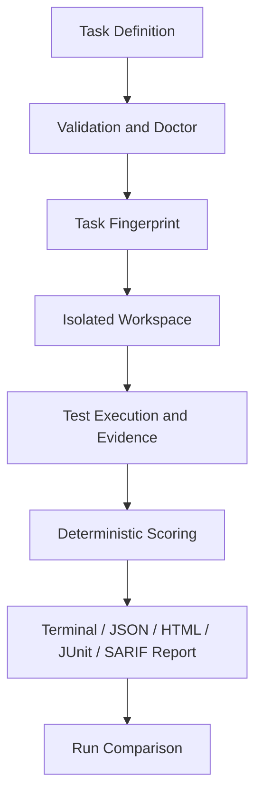

# RepoGym

RepoGym turns real software issues into reproducible, testable, and quantitatively scored AI
coding tasks.

AI coding evaluations are most useful when the task contract, starting state, hidden checks,
and scoring formula can be inspected and replayed. RepoGym packages those pieces in a small,
versioned directory and produces durable run artifacts instead of a single opaque pass/fail.

## Features

- Versioned TaskSpec validation with backward-compatible schema migration
- Public and private pytest suites with reference-solution verification
- SHA-256 task fingerprints over every versioned task input, including the reference patch
- Environment diagnostics for commands, dependencies, working directories, and test discovery
- Temporary workspaces and a replaceable executor interface
- Generic `python` task commands are bound to the interpreter running RepoGym
- Deterministic correctness, regression, static-quality, and scope scores
- Deterministic run-to-run comparison in terminal or JSON form
- Terminal, JSON, self-contained HTML, JUnit XML, and SARIF reports
- Preflight submission auditing for scope, links, reparse points, size, and sensitive filenames
- Bounded process output, process-tree timeout cleanup, and unified path redaction
- Cooperative cancellation with the same cross-platform process-tree cleanup as timeouts
- Versioned command, test, environment, and artifact evidence in deterministic order
- Atomic content-addressed execution caching with corruption recovery and per-key locking
- Integrity-checked, versioned ZIP export and atomic import of portable tasks
- Two original, runnable Python tasks

## Quick start

RepoGym requires Python 3.11 or newer.

```bash
git clone https://github.com/chenwei217/RepoGym.git
cd repogym
python -m pip install -e ".[dev]"
repogym --help
repogym list
```

Validate and verify a task, grade the included correct submission, and render its report:

```bash
repogym validate tasks/python-cache-ttl
repogym doctor tasks/python-cache-ttl
repogym verify tasks/python-cache-ttl
repogym grade tasks/python-cache-ttl --submission examples/submissions/cache-ttl-fixed
repogym cache verify
repogym report .repogym/runs/<run-id> --format html --output report.html
repogym compare .repogym/runs/<run-a> .repogym/runs/<run-b>
repogym bundle export tasks/python-cache-ttl python-cache-ttl.zip
repogym bundle import python-cache-ttl.zip --destination imported-tasks
```

Run the project checks:

```bash
ruff check .
ruff format --check .
mypy src/repogym
pytest --cov=repogym --cov-report=term-missing
```

## CLI

| Command | Purpose |
| --- | --- |
| `repogym list [--tasks-dir PATH]` | Discover valid task definitions |
| `repogym validate TASK` | Check metadata, paths, and required files |
| `repogym doctor TASK` | Diagnose the local execution environment |
| `repogym verify TASK` | Prove the starter fails and the reference fix passes |
| `repogym grade TASK --submission DIR [--no-cache]` | Grade a candidate with incremental caching |
| `repogym report RUN --format terminal\|json\|html\|junit\|sarif [--output FILE]` | Re-render saved run artifacts |
| `repogym compare RUN_A RUN_B --format terminal\|json [--output FILE]` | Compare two persisted runs |
| `repogym bundle export TASK OUTPUT` | Export a versioned, integrity-checked task package |
| `repogym bundle import BUNDLE --destination DIR` | Verify and atomically import a task package |
| `repogym cache list\|verify\|clear` | Inspect or maintain execution cache entries |
| `repogym version` | Print the installed version |

Pass `--debug` before a command to show tracebacks for expected domain errors.

### Automation exit codes

RepoGym uses stable process codes: `0` success, `10` invalid task or input, `20` execution
failure, `30` a completed grade below 100, `40` environment or artifact I/O failure, and `70`
an unexpected internal error. Command-line syntax errors remain Typer's standard code `2`.

In POSIX shells, capture the code immediately:

```bash
repogym grade tasks/python-cache-ttl --submission candidate
code=$?
test "$code" -eq 0 || echo "RepoGym outcome: $code"
```

PowerShell exposes the same contract through `$LASTEXITCODE`:

```powershell
repogym grade tasks/python-cache-ttl --submission candidate
if ($LASTEXITCODE -eq 30) { Write-Host "Valid run, score below 100" }
```

CI runners fail a step naturally for every nonzero outcome; branch on `30` only when a below-100
candidate is expected data rather than a failed gate.

### Incremental execution cache

The CLI caches completed grades under `.repogym/cache` and still materializes a distinct run under
`.repogym/runs` for every invocation. A cache hit is shown in terminal output and recorded in
`result.json` and `metadata.json` with the source run ID. Use `--no-cache` for a one-off fresh run,
or `--cache-dir PATH` to select a different cache. Python callers remain uncached unless they pass
`cache_root` to `grade_submission`.

Keys cover the complete task fingerprint, submission file hashes, resolved command, executor
identity and output limits, Python/OS identity, and RepoGym version. Only completed runs are
published. Entries use per-key locks and atomic directory publication; a hash or membership
mismatch is discarded and recomputed on the next grade. `repogym cache list`, `cache verify`, and
`cache clear` inspect integrity or remove the entries present when clearing begins.

## Reproducibility and diagnostics

Every grade stores a SHA-256 task fingerprint in both `metadata.json` and `result.json`. The
digest covers normalized relative paths and exact bytes for `task.yaml`, `prompt.md`, the
configured description, `starter/`, public and private tests, and `reference/solution.patch`.
Changing any of those inputs changes the fingerprint; mtimes and file creation order do not.

Run `doctor` before a long evaluation to inspect the current environment. This output was
captured from the bundled cache task; the Python version and interpreter path will reflect the
local runtime:

```text
$ repogym doctor tasks/python-cache-ttl
PASS task definition: Loaded python-cache-ttl.
PASS starter project: Starter project directory exists.
PASS python version: Python 3.14.4; requires 3.11+.
PASS test command: Executable found: /path/to/venv/bin/python
PASS dependencies: Python module available: pytest
PASS working directory: Starter working directory exists: .
PASS public test discovery: 4 public tests found.
PASS private test discovery: 4 private tests found.
PASS temporary directory: Temporary workspace is writable.
PASS task fingerprint: Deterministic SHA-256:
d92dfb7b7bc039787c17692ef75e74d20c8ddf0906c05efa78f2a95bac64ddb0
```

When a task command starts with exactly `python` or `python.exe`, RepoGym replaces that first
argument with `sys.executable`. Consequently, virtual-environment and pipx installations run
tests with the same interpreter that runs RepoGym, even when another Python appears first on
`PATH`. Explicit absolute Python paths, other interpreter names, and non-Python commands are
left unchanged. Commands are always passed as argument lists with `shell=False`.

## Comparing runs

`compare` reports B minus A for the total score, every scoring dimension, passed/failed/total
tests, duration, status, timeout state, and violations. For the bundled broken and fixed cache
submissions, an actual local run produced:

```text
Metric             Run A  Run B   Delta
total score        20.00  100.00  +80.00
correctness         0.00   60.00  +60.00
regression_safety   0.00   20.00  +20.00
tests passed        0       8      +8
tests failed        8       0      -8
tests total         8       8      +0
Status: completed -> completed; timed out: False -> False
Violations added: 0; removed: 0
```

Use `--format json` and optionally `--output FILE` for automation. Comparisons read immutable
run artifacts and never re-run candidate code. A task-ID mismatch is an error; a fingerprint
mismatch is a prominent comparability warning.

## Task specification

Each task owns its prompt, starter tree, test suites, and reference patch:

```text
tasks/my-task/
├── task.yaml
├── prompt.md
├── starter/
├── tests/
│   ├── public/
│   └── private/
└── reference/
    └── solution.patch
```

```yaml
schema_version: 1
id: my-task
title: Repair an edge case
difficulty: medium
language: python
version: "1.0"
description_file: prompt.md
execution:
  timeout_seconds: 30
  test_command: python -m pytest -q
  working_directory: "."
scoring:
  correctness: {weight: 60}
  regression_safety: {weight: 20}
  code_quality: {weight: 10}
  scope_control: {weight: 10}
expected:
  failing_tests_before: 2
  passing_tests_after: 8
constraints:
  allowed_paths: [src/**, tests/**]
  forbidden_paths: [pyproject.toml, repogym/**]
```

See [Task authoring](docs/task-authoring.md) for the complete design guidance.

`schema_version` identifies the task file format and is separate from the task content's
`version`. Newly authored tasks must use schema version 1. Definitions created before schema
versioning, which omit the field or explicitly use version 0, are migrated in memory without
rewriting their files. RepoGym rejects unknown future versions rather than guessing their meaning.

## Scoring model

Scores are calculated at run time; no result is hard-coded. Correctness is the weighted ratio
of all passed tests. Regression safety applies the same formula to public tests. Code quality
splits its weight equally between Python syntax and Ruff. Scope control gives full credit for
in-scope changes, proportionally deducts outside changes, and gives zero if a forbidden path is
changed. See [Scoring](docs/scoring.md) for edge cases and exact formulas.

## HTML report

The HTML renderer emits one portable file with no CDN dependency. It contains the overall
score, every scoring dimension, test statistics, violations, duration, and collapsed process
output. Untrusted output is HTML-escaped and local absolute paths are redacted first.

## Machine reports

Use `--format junit` to export aggregate test outcomes for CI test viewers. The suite carries the
recorded total, failure, derived skipped, and duration values, with deterministic synthetic case
names because RepoGym currently persists aggregate rather than per-test results. Use `--format
sarif` to export scope violations for code-scanning tools; known relative paths and line suffixes
become SARIF physical locations. Both formats are deterministic and reuse the run loader's path
redaction. Pass `--output report.xml` or `--output report.sarif` to write a file.

## Architecture



The `Executor` protocol separates orchestration from process execution. The current release
ships a `LocalExecutor`; a future container executor can implement the same interface. More
detail is in [Architecture](docs/architecture.md).

Python callers can cooperatively stop local execution with a thread-safe token:

```python
from repogym.executors import CancellationToken, LocalExecutor

token = CancellationToken()
# Call token.cancel() from a signal handler or coordinating thread.
result = LocalExecutor().execute(command, workspace, 60, cancellation_token=token)
assert result.cancelled or result.return_code is not None
```

Cancellation is idempotent. A token cancelled before launch prevents the child from starting;
during execution it terminates the same captured process tree as a timeout. Results distinguish
`cancelled`, `timed_out`, nonzero exits, and launch failures.

## Security model

**LocalExecutor is not a sandbox.** Task tests and candidate code execute as the current OS
user and must be trusted. RepoGym audits submissions before copying, rejects links and path
escapes, and terminates the recorded process tree on timeout, but those controls do not contain
malicious code. Use a disposable VM or appropriately configured container for untrusted
material. Read [Security model](docs/security-model.md) before operating a shared service.

Persisted execution evidence includes a sanitized argument vector, exit code, timeout state,
duration, `<WORKSPACE>` working directory, output artifact names, test-statistics source, and
termination diagnostics. It also records the original stdout/stderr byte counts and whether
either stream was truncated. `LocalExecutor` retains at most 1 MiB per stream by default, split
between the beginning and end so diagnostics and final test summaries remain useful; Python API
callers can set independent positive limits. The same redaction policy is applied to captured
output, JSON, terminal, HTML, and comparisons; environment variables and tokens are never
recorded automatically.

Each new run also writes `evidence.json` using evidence schema version 1. Its records cover the
executed command, parsed test statistics, non-secret runtime identity, and sanitized output
artifacts. Every record has a source, observation time, status, summary, and task association;
records are sorted by stable semantic keys. The loader synthesizes equivalent v1 evidence for
older runs that predate this file.

Detailed workflows: [CLI reference](docs/cli.md),
[reproducibility](docs/reproducibility.md), [run comparison](docs/run-comparison.md),
[task bundles](docs/task-bundles.md), and [project milestones](docs/milestones.md).

## Roadmap

The following capabilities are planned and are not present in the MVP:

- Docker/OCI executor with resource and network policies
- GitHub issue importer
- coding-agent adapters and batch evaluation
- richer language-specific test result adapters

## Contributing

Bug reports, task proposals, and focused pull requests are welcome. See
[CONTRIBUTING.md](CONTRIBUTING.md) for local checks and task review expectations.

## License

Apache License 2.0. See [LICENSE](LICENSE).
